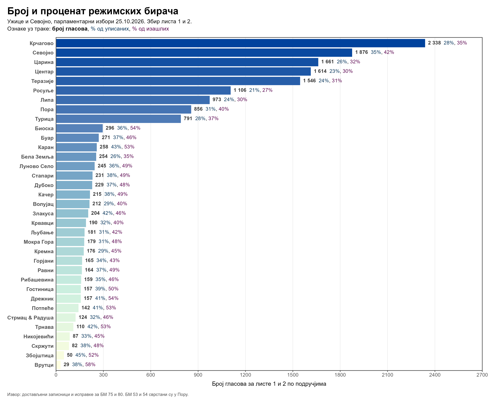

# Izbori 2026: Užice i Sevojno

Obrada dostavljenih zapisnika, ispravki i primedbi za parlamentarne izbore 25.10.2026, sa dijagramom glasova po područjima Užica i Sevojna.

Obuhvaćeno je svih **89 biračkih mesta** i **35 područja**. Na dijagramu se prikazuje zbir glasova lista **1 i 2**, uz procente od upisanih i od izašlih birača. Ukupan zbir glasova tih lista je **17.328**.



## Fajlovi

| Putanja | Sadržaj |
|---|---|
| `election_dataset_2026.csv` | Zbirni podaci za 35 područja |
| `election_dataset_2026_biracka_mesta.csv` | Podaci za svih 89 biračkih mesta, svih 18 lista, izvori i kontrole |
| `skripta_izbori_2026.R` | Generisanje zbirnog dataset-a i dijagrama |
| `election_plot_2026.png` | Konačan dijagram, 4200 × 3450 piksela |
| `metodologija_2026.md` | Pravila računanja, dopune, primena ispravki i provere |
| `zapisnici_primedbe_ispravke/` | Izvorni PDF dokumenti |
| `uzice_izbori_2026_mapiranje_birackih_mesta.xlsx` | Izvorno mapiranje biračkih mesta na područja |
| `obrada_2026/` | Transkripcija, mapiranje u JSON-u, dopuna korisnika i pomoćne skripte |

Fajlovi `election_dataset.csv`, `skripta_izbori.R` i `election_plotxx1.png` predstavljaju raniju analizu lokalnih izbora, korišćenu kao uzor za izgled dijagrama.

## Ponovno generisanje

Potrebni su R i paketi `ggplot2`, `ggtext` i `ragg`:

```r
install.packages(c("ggplot2", "ggtext", "ragg"))
```

Iz korena repozitorijuma:

```sh
Rscript skripta_izbori_2026.R
```

Skripta čita detaljni CSV, proverava računske veze i generiše zbirni CSV i PNG. X-osa dijagrama završava na 2700.

Za ponovno pravljenje detaljnog CSV-a iz sačuvane transkripcije, mapiranja i dopune korisnika, dovoljan je Python 3 sa standardnom bibliotekom:

```sh
python obrada_2026/build_station_dataset.py
Rscript skripta_izbori_2026.R
```

Pomoćne skripte za vizuelni pregled koriste Pillow i PyMuPDF, a nezavisna provera koristi pandas i NumPy. Privremeni PNG pregledi i radni snimci prethodnih dataset-a izostavljeni su iz Git-a.

## Obrada podataka

- BM 53 i 54 u Užicu svrstani su u **Пора**, prema zahtevu korisnika. Izvorno mapiranje ostaje sačuvano.
- Broj upisanih birača za užičko BM 5 dopunjen je podatkom korisnika: **387**. Poreklo dopune zabeleženo je u `obrada_2026/user_overrides.json`.
- Primenjena su rešenja o ispravkama za užička BM 75 i 80.
- Procenat od izašlih koristi broj izašlih iz tačke 11.1 zapisnika. Razlike između tog broja i listića u kutiji sačuvane su u dataset-u.
- Naziv `num_votes_opposition` zadržan je radi kompatibilnosti sa ranijim dataset-om i označava sve glasove ostalih lista. Precizniji naziv iste mere je `num_votes_other_lists`.

Detalji i kontrolni zbirovi nalaze se u [metodologiji](metodologija_2026.md). Otisci izvornih PDF-ova sačuvani su u `obrada_2026/source_manifest.json`.
